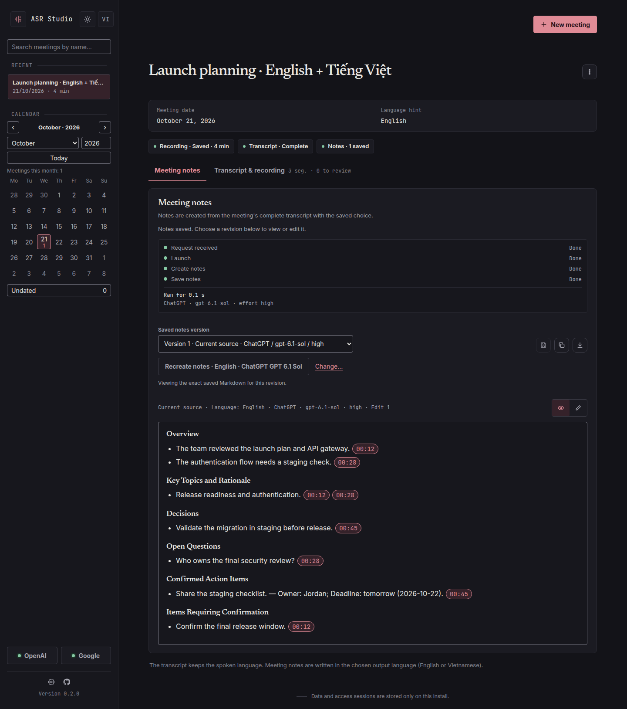
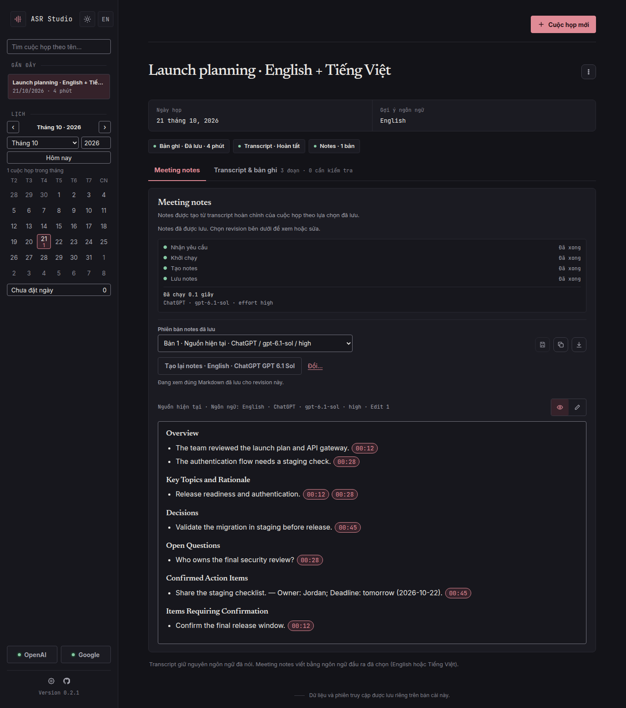
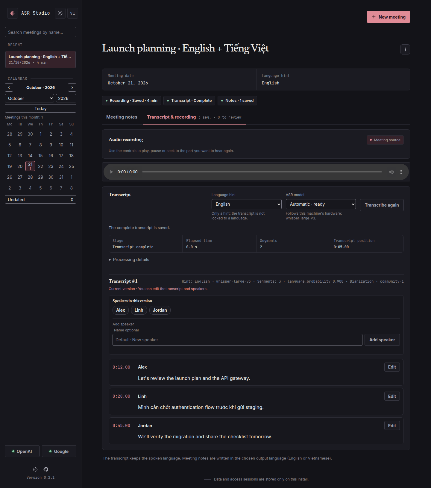
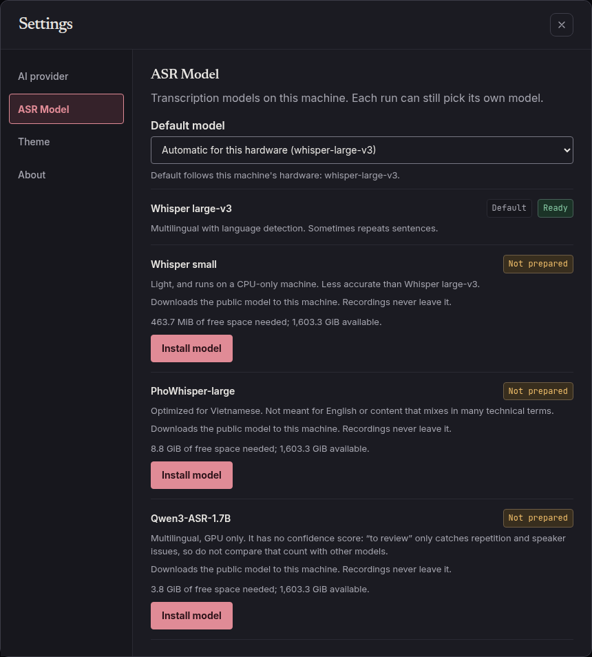
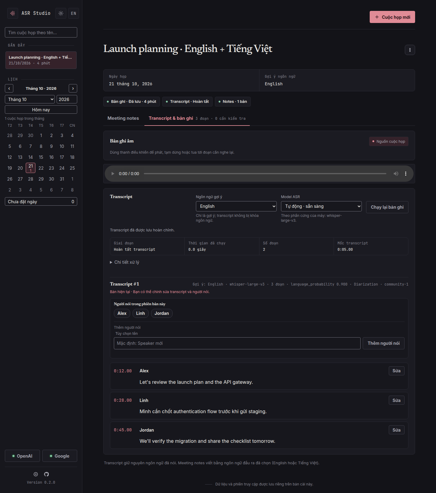
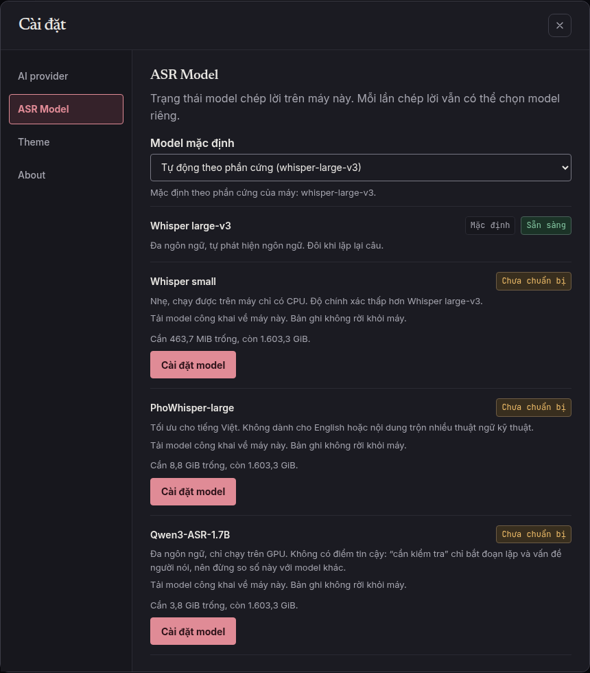

<div align="center">


**Private meeting transcription and notes for English and Vietnamese**

_Recordings are transcribed on your own machine. Only the transcript goes to the notes
provider you choose, and every note links back to the moment in the recording it came from._

[](https://github.com/nguyencanhtrung/asr-studio/actions/workflows/pipeline.yml)
[](https://github.com/nguyencanhtrung/asr-studio/releases)
[](#license)
[](pyproject.toml)
[](https://github.com/nguyencanhtrung/asr-studio/commits/main)

[Quickstart](#quickstart) · [Features](#features) · [Docs](#documentation) · [License](#license)



</div>

<details>
<summary><strong>Giao diện tiếng Việt</strong></summary>
<br>
<p align="center">
  
</p>
</details>

## Screenshot provenance

The README screenshots are reproducible synthetic examples in the dark theme, in English and
Vietnamese, not acceptance evidence. Regenerate them with:

```sh
uv run python scripts/capture-readme.py
```

The script reads only the repository [synthetic fixture](tests/fixtures/readme-demo.json), starts a
fresh temporary local app, uses a stub notes provider and a stubbed connected account, captures at
a width of 1440, and rejects non-loopback browser requests. It does not read recordings, credentials or provider sessions, run
ASR/inference, or use a user's browser.

## Renaming an existing checkout

The product and Python package are now `ASR Studio` and `asr_studio`.
Run Python commands with `python -m asr_studio.cli`; rebuild the local image with
`./scripts/start.sh --source` before starting the updated Compose services.
Use `ASR_IMAGE=asr-studio:local` for a source build. Images published before the
rename retain their original package names and must use the Compose file from
their release tag. Archived release inventories describe those original images.

Compose keeps the existing deployment name `asr-en-vi` so renaming the checkout
folder does not switch to empty data, auth or provider volumes. Keep any custom
`COMPOSE_PROJECT_NAME` override you previously used. Browser preferences and
pending request keys migrate automatically on the next page load at the same origin.
After moving a checkout with a virtual environment, run `uv sync --all-groups --locked`
to refresh its editable install and command paths.

## Overview

ASR Studio is a self-hosted web app for meeting recordings. You upload a recording and get back a
transcript with speaker labels. From that transcript the app writes structured meeting notes.
Speech recognition and speaker diarization run locally in Docker, on a GPU if one is available and
on the CPU otherwise.

## Features

- **Local transcription.** Uses Qwen3-ASR-1.7B on a GPU and
  [faster-whisper](https://github.com/SYSTRAN/faster-whisper) Whisper small on a CPU by default.
  Whisper large-v3, PhoWhisper-large and Qwen3-ASR-1.7B remain available choices. Language is
  detected for each segment, so meetings that mix English and Vietnamese are transcribed as spoken.
- **ASR model choice.** Choose a model for one run or as the default in Settings, and install models
  from there. Each run keeps its own transcript version, so you can compare models on one recording.
  See [Hardware by ASR model](#hardware-by-asr-model).
- **Speaker diarization.** Uses
  [pyannote Community-1](https://huggingface.co/pyannote/speaker-diarization-community-1). Speakers
  get default names that you can change, and segments with overlapping speech or low confidence are
  flagged for review.
- **Repeated text flags.** Three or more identical segments in a row are flagged for review on every
  model, whoever the speaker is.
- **Editable transcripts.** You can correct the text and speaker of each segment. Running a
  transcription again creates a new version and keeps the previous one.
- **AI meeting notes.** Notes are generated in English or Vietnamese through ChatGPT or Google
  Antigravity (via OMP). They include an overview, key topics, decisions, open questions and action
  items.
- **Timestamp citations.** Each note item links to its source segments, so you can jump to that
  point in the recording and play it.
- **Versioned Markdown notes.** You can edit notes in Markdown, keep earlier versions, and copy or
  download them.
- **Private by default.** The app is published only on the host's loopback address and is accessed
  with a token link. Audio and models stay on the host. Notes send the transcript to the provider
  you connect. Containers can reach the internet; see [Network access](docs/user-guide.md#network-access).

<p align="center">
  
</p>

<p align="center">
  
</p>

<details>
<summary><strong>Giao diện tiếng Việt</strong></summary>
<br>
<p align="center">
  
</p>
<p align="center">
  
</p>
</details>

## Prerequisites

- Docker Engine with Docker Compose 2.30 or later
- `git-lfs`, and a Hugging Face account that has accepted the
  [Community-1 conditions](https://huggingface.co/pyannote/speaker-diarization-community-1)
- Optional: an NVIDIA GPU with the NVIDIA driver and NVIDIA Container Toolkit
- Optional, for notes: a ChatGPT account, or OMP with Google Antigravity

### Hardware by ASR model

The app runs one model at a time, so the GPU needs room for the larger of the ASR model and
diarization. Diarization alone peaks at about 4228 MiB of VRAM.

| Model | Runs on | Minimum VRAM (estimate) | Peak VRAM measured | Disk | CPU memory measured |
| --- | --- | ---: | ---: | ---: | ---: |
| Qwen3-ASR-1.7B (GPU default) | GPU only | 10 GB | 8336 MiB | 4.1 GB | Refused on CPU |
| Whisper large-v3 | GPU or CPU | 6 GB | 5554 MiB | 3.1 GB | 2824 to 4784 MiB |
| PhoWhisper-large | GPU or CPU | 6 GB | 5518 MiB | 3.1 GB, 9.5 GB free to install | 2538 to 2842 MiB |
| Whisper small (CPU default) | CPU or GPU | 6 GB | 4228 MiB, from diarization | 0.5 GB | 1767 to 2374 MiB |

Minimum VRAM is the next common card size above the measured peak. It is an estimate: every run
used one 16 GB RTX 5080, and no smaller card was tested. VRAM peaks come from meetings of up to 75
minutes, except Whisper small, which was measured on 3-minute clips. Some repeat runs in a
comparison script reported about 12100 MiB, likely from loading a model again in one process. The
app starts a new process for each run, and that case was not measured in the app. CPU memory is the container
peak on clips under one minute, so a full meeting can need more, and system memory on a GPU run was
not measured. On a CPU, Whisper small takes about 0.4 minutes per minute of audio, and the large
models 0.6 to 1.5.

For recordings near the four-hour limit, budget at least **8 GiB system RAM with 6 GiB available
to the worker** for diarization. These are provisional deployment budgets; allow extra memory for
the selected ASR model and other processes. Current and historical four-hour synthetic runs exceed
4 GiB runner RSS. See the [memory measurements and limits](docs/release/diarization-memory.md).

## Quickstart

```sh
cp .env.example .env

# Download the diarization model (enter a Hugging Face access token when prompted)
git lfs install
git clone https://hf.co/pyannote/speaker-diarization-community-1 \
  ./models/speaker-diarization-community-1

./scripts/start.sh
```

`start.sh` downloads any missing default ASR model, builds the image and starts the `app` and `worker`
services, plus a `model-installer` that adds the other ASR models from
**Settings → ASR Model** (the only service that downloads models and writes `./models`; it sees no recordings). On an interactive terminal it prints an access link and a QR code. When stdout is a
pipe, redirect or CI log, access details are withheld; run `docker compose exec -T app python -m
asr_studio.cli access show` explicitly when you want to display them. Open that exact link (the
default address is `http://127.0.0.1:8765`), then connect ChatGPT or Google from the workspace
header.

To install a release, check out its tag and run `./scripts/start.sh --pull` with a versioned
`ASR_IMAGE` copied from that release’s published instructions, or `--source` to build it.
After setup, `--offline` starts without building, pulling or downloading anything. It does not
block the containers' network. See
[Install a release](docs/user-guide.md#install-a-release).

## Documentation

Release process documents use English. Most design and historical documents use Vietnamese.

| Topic | Document |
| --- | --- |
| Operations: configuration, models, notes providers, tokens, CI/CD | [User guide](docs/user-guide.md) |
| Releases: process, checks, notes, and evidence | [Release guide](docs/release/README.md) · [Published releases](https://github.com/nguyencanhtrung/asr-studio/releases) |
| Product context and vocabulary | [PRODUCT.md](PRODUCT.md) · [CONTEXT.md](CONTEXT.md) |
| Specification | [Specification v1](docs/specification.md) |
| Design | [Design system](DESIGN.md) · [Frontend](docs/frontend-design.md) · [Backend](docs/backend-design.md) · [Backend contract](docs/backend-contract.md) |
| Architecture decisions | [ADRs](docs/adr/) |
| Contributing | [Coding standards](CODING_STANDARDS.md) · [Agent guide](AGENTS.md) · [Development checks](docs/agents/development.md) |

## License

Original project code is licensed under [PolyForm Noncommercial 1.0.0](LICENSE).
Commercial use, including use for a commercial business's internal meetings,
requires separate permission from [the owner](https://github.com/nguyencanhtrung).
Uses expressly permitted by the license's Noncommercial Organizations section remain permitted.
Third-party dependencies, fonts and models retain their own licenses.

Mã gốc của dự án dùng [PolyForm Noncommercial 1.0.0](LICENSE). Dùng cho mục đích thương mại, kể cả tổng kết
cuộc họp nội bộ phục vụ kinh doanh, cần được [chủ sở hữu](https://github.com/nguyencanhtrung)
cho phép riêng. Các mục đích được cho phép rõ ràng trong phần Tổ chức phi thương mại vẫn
được phép. Dependency, font và model bên thứ ba giữ license riêng.
